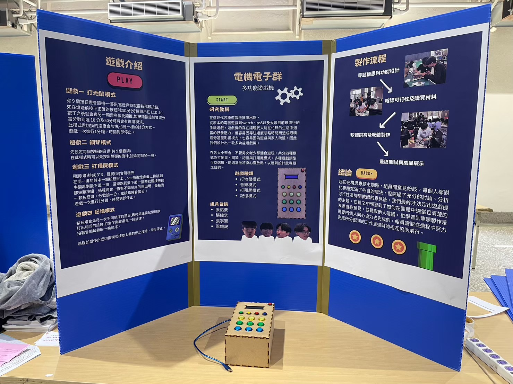

# Arduino 多功能互動遊戲機｜高中專題

> 高中四人專題，**主要 Arduino 程式設計與遊戲控制邏輯由我獨立負責**。

## 專題簡介
利用 Arduino 控制 **9 組按鈕與 LED、16×2 I2C LCD、蜂鳴器及模式選擇開關**，實作一台具備四種互動模式的遊戲機。這是高中時期完成並在專題成果活動展出的實體作品。

## 四種模式

| 模式 | 功能 |
| --- | --- |
| 打地鼠 | 隨機點亮 LED，玩家按對應按鈕計分；分數上升後可加快節奏 |
| 鋼琴 | 按下不同按鈕觸發不同音高並顯示燈號 |
| 打殭屍 | 依不同燈號位置進行按鍵反應與計分 |
| 記憶 | 顯示燈號序列，玩家依順序操作按鈕 |

另提供重置模式，以清除分數與遊戲狀態。

## 使用技術
- Arduino C/C++、GPIO 數位輸入輸出
- `INPUT_PULLUP` 按鈕讀取、LED 與蜂鳴器控制
- I2C LCD (`Wire.h`, `LiquidCrystal_I2C.h`)
- `millis()` 計時、隨機數、陣列、函式及基本流程控制

## 硬體概況
- 控制板：原始程式使用數位腳位 31–44，**推測為 Arduino Mega 系列**，型號未由實體照片確證
- LED：9 組（GPIO 4–12）
- 按鈕：9 組（GPIO 31–39）
- 模式選擇：5 組輸入（GPIO 40–44）
- LCD：I2C 16×2，程式預設位址 `0x27`
- 蜂鳴器：GPIO 13

## 程式版本說明
`Arduino_MultiGame.ino` 為**根據當年留存的原始程式所整理的重構示範版**，並非當年的逐字原始碼，部分流程（例如按鈕去彈跳、模式切換、記憶遊戲時序）已重整。
## 安裝與測試
1. Arduino IDE 安裝 `LiquidCrystal_I2C` 相容函式庫。
2. 選擇相符的 Arduino Mega 系列控制板並連接實際硬體。
3. 核對 LCD I2C 位址、腳位對應及按鈕上拉接法後再上傳。
4. 開啟序列埠監控（9600 baud）；依模式逐一測試。
5. 硬體接線與電氣安全需依實際元件規格確認。

## 個人貢獻
高中四人專題中，主要負責 Arduino 程式架構、遊戲邏輯與 I/O 控制程式；硬體與展示成果為團隊作品。

## 素材來源
成果照片為當年的專題展示記錄。
